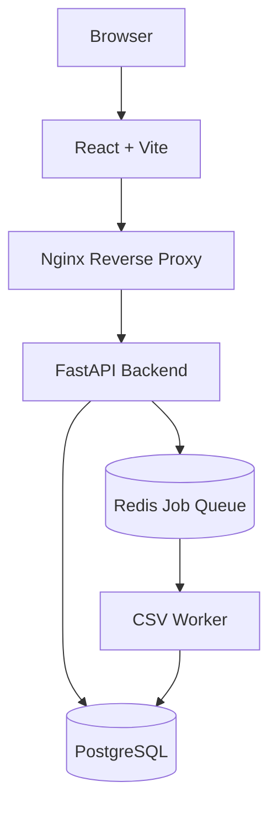

# JobFlow — Distributed Job Processing Platform

JobFlow is a containerized CSV job-processing platform built to demonstrate application development, container orchestration, reliability, and DevOps practices.

## Architecture and versions

- **V1.2.0:** Docker Compose baseline.
- **V2.0.0:** Kubernetes migration; release pending final verification.

The application retains the same six core services across both deployment models.



## Technology stack

- Frontend: React and Vite
- Reverse proxy: Nginx
- API: Python and FastAPI
- Background processing: Python worker
- Job queue: Redis
- Database: PostgreSQL
- Containerization: Docker and Docker Compose
- Orchestration: Kubernetes on k3d for local development
- Testing: pytest

## Kubernetes deployment

The Kubernetes manifests are in `k8s/`.

The current local deployment includes:

- Namespace: `jobflow`
- Deployments: `frontend`, `nginx`, `backend`, `worker`, `redis`, `postgres`
- Services for internal communication
- Kubernetes Secret for database credentials
- ConfigMap for Nginx configuration
- PersistentVolumeClaims for PostgreSQL, Redis, and uploaded files
- Resource requests/limits and health probes

See [Kubernetes Operations](docs/kubernetes.md) for prerequisites, deployment commands, validation, troubleshooting, and limitations.

The Kubernetes application is accessed locally through:

```bash
kubectl port-forward -n jobflow svc/nginx 8082:80
```

Then open <http://localhost:8082>.

Keep the port-forward terminal open while using the application.

## Docker Compose baseline

The original Compose configuration remains in `compose.yaml`. Its operational guidance is preserved in:

- [Docker deployment](docs/docker.md)
- [Operations and troubleshooting](docs/operations.md)

Do not remove Compose volumes as part of Kubernetes maintenance. Compose and Kubernetes use separate storage resources.

## Testing and validation

Run the backend tests from the repository root:

```bash
backend/.venv/bin/python3 -m pytest backend/tests -q
```

The latest recorded validation passed all 9 backend tests, with one Starlette deprecation warning.

The Kubernetes end-to-end CSV test also completed successfully: a submitted CSV was processed by the worker, the job reached `COMPLETED`, and SSE emitted the completion result.

See [Testing and Validation](docs/testing.md) and [API Reference](docs/api.md).

## Documentation

- [Architecture](docs/architecture.md)
- [API Reference](docs/api.md)
- [Docker Guide](docs/docker.md)
- [Operations and Troubleshooting](docs/operations.md)
- [Kubernetes Operations](docs/kubernetes.md)
- [Testing and Validation](docs/testing.md)
- [Roadmap](docs/roadmap.md)

## Known limitations

- The Kubernetes deployment is a local k3d environment, not a production cloud deployment.
- Local-path volumes are tied to the local cluster/node and do not provide production-grade high availability.
- Redis AOF improves queue persistence but does not provide a complete job acknowledgement/retry system.
- A worker interruption during processing can leave a job requiring recovery; durable queue delivery and idempotent retries remain future reliability work.
- The worker has recorded one restart during Redis rollout. Subsequent processing succeeded, but this does not prove every failure scenario is recoverable.
- CI/CD, Kafka, and Terraform are future roadmap stages, not claims of completed implementation.

## Project principle

**Keep the application, evolve the infrastructure.**

The long-term roadmap progresses from Compose to Kubernetes, then CI/CD, event-driven processing, and infrastructure as code.
